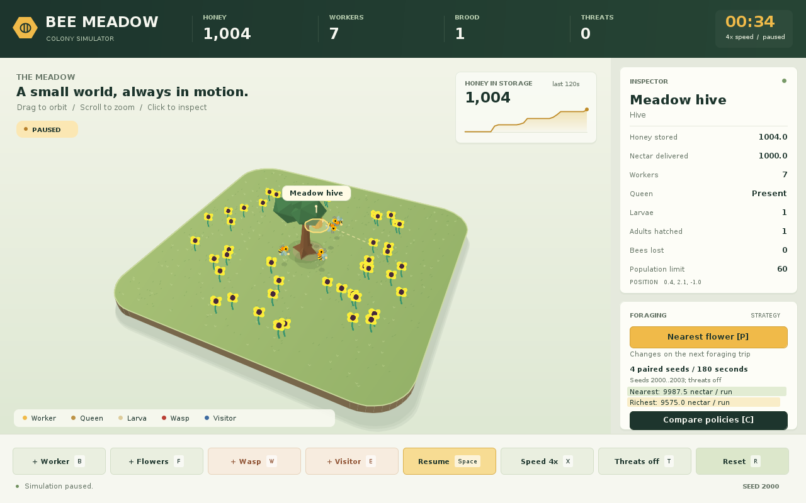

# Bees — Week 13

A watchable Java bee-colony simulation with foraging, nectar delivery, queen/larva growth, defensive workers, wasps and an exterminator. The desktop uses **standard Java Swing/Java2D** and the original meadow assets. There are no third-party Java libraries, native bindings, Maven or Gradle dependencies.



## Run

Install a **JDK 17 or newer** (`java` and `javac` on PATH), extract the entire project, then run:

| Platform | Open desktop | Run Java tests |
| --- | --- | --- |
| Linux / macOS terminal | `bash run.sh` | `bash test.sh` |
| Windows Command Prompt | `run.bat` | `test.bat` |
| Windows PowerShell | `.\run.bat` | `.\test.bat` |

A desktop display is needed for the window. No display is needed for the model or experiment:

```sh
bash run.sh --headless --seconds 300 --policy richest
bash run.sh --compare --runs 4 --seconds 180 --seed 2000 --parallel > comparison.csv
```

Use `run.bat` instead of `bash run.sh` on Windows. `--threats` enables automatic visitors in a headless run or comparison. `--help` lists the remaining options. `--seconds` defaults to 120; comparisons accept 0–3600 seconds and 1–32 seeds per policy.

The desktop starts within the monitor's available area, accounting for the taskbar and window decorations. It adapts the inspector spacing on shorter screens so the bottom controls remain accessible.

The meadow uses a rounded terrain surface, directional shading on the original tree, soft shadows, larger sprites, selection rings and hover feedback. The honey chart shows up to 120 recent samples, approximately one per simulated second; it freezes with pause and clears on reset. The static terrain layer is cached until the camera or window size changes. These are presentation features and do not alter simulation rules or random seeds.

For a manual build, from the project root:

```sh
javac --release 17 -encoding UTF-8 -proc:none -Xlint:all -Werror -sourcepath src -d build/classes src/App.java
java -cp build/classes App
```

Keep `Assets/` beside `src/`. The launch scripts change to the correct directory automatically. Invoking them with `bash` also works when a browser upload or download does not preserve executable permissions.

## Controls

| Control | Action |
| --- | --- |
| B / F | Add a worker / ten flowers |
| W / E | Add a wasp / exterminator |
| Space / X | Pause or resume / cycle 1x, 2x, 4x speed |
| T / R | Toggle automatic threats / reset the seeded colony |
| P / policy button | Switch nearest-flower and richest-flower strategies |
| C / compare button | Run four paired seeds for 180 seconds per world in the background |
| Left click / H / Q / Tab | Inspect an object / hive / queen / next object |
| Right drag / Left and Right arrows | Orbit the camera |
| Mouse wheel / Up and Down arrows | Zoom |
| Page Up / Page Down / Home | Tilt / restore the camera |
| G / F12 / Escape | Show foraging paths / save screenshot / exit |

Policy changes affect each worker's **next** reservation. Existing trips retain their flower. Reset keeps the selected policy and seed, and resets speed, pause and automatic threats.

The comparison creates eight **separate** worlds: both policies for each of four seeds. It uses the live world's seed and current automatic-threat setting, but does not copy its current bees, resources, time or manually added visitors. The result panel reports mean nectar delivered, and the console prints the individual CSV rows. The live colony continues independently.

## Week 13 implementation

- **Strategy:** `FlowerSelectionStrategy` separates flower ranking from the worker state machine. Nearest and richest policies can be selected through the desktop, CLI and experiments.
- **Simple Factory:** the retained `BeeFactory` centralizes worker/queen creation through `Hive.addBee`. This is a simple factory, not the GoF Factory Method pattern.
- **Streams and lambdas:** filtering/ranking, UI callbacks, deterministic trial generation, grouping and summary statistics.
- **Safe parallel trials:** each task owns an entire `Simulation` and its random generator. The live model stays on Swing's event dispatch thread. Immutable result records cross the background/UI boundary.
- **Reproducible behavior:** the existing fixed-step model, exclusive reservations, nectar conservation, bounded populations and predator interactions remain intact.

Read [the technical notes](docs/WEEK13-TECHNICAL-NOTES.md) for source locations, snippets, trade-offs and evidence. The required [design-pattern diagram PDF](docs/design-patterns.pdf) contains two pages. [Changes from the supplied Week 7 archive](docs/CHANGES-FROM-WEEK7.md) distinguish retained code from this update.

## Verification

`test.sh` / `test.bat` run 25 existing regression tests and 11 Week 13 tests. The latter include real policy divergence, exact serial/parallel agreement, runtime strategy replacement and camera/picking geometry. The tests use no external testing framework.

Optional Linux desktop automation uses Python 3, Xvfb and xdotool:

```sh
xvfb-run -a -s '-screen 0 1440x1000x24' python3 tests/gui_smoke.py
python3 tests/launch_checks.py
python3 tests/screen_sizes.py
```

These are development tools, not application dependencies. See [verification results and limits](docs/VERIFICATION.md). Windows and macOS launchers are included; their native desktops have not been tested in this Linux environment.

## Delivery and provenance

This update was developed with AI assistance from the supplied `COMP2000-BEES-Completed (1).zip`. The earlier model, assets and pattern foundations are retained; the graphics migration, second policy, experiment runner and Week 13 supporting material are additions. Original notes under `docs/week7-reference/` and diagrams under `docs/media/` are historical references, not current verification.

The individual submission repository is [christopheryoussef-lang/COMP2000-BEES-Week13](https://github.com/christopheryoussef-lang/COMP2000-BEES-Week13), a public fork of [the team's repository](https://github.com/NewSuperMarioBrosWii/COMP2000-BEES). The team's commit history is retained. The delivered implementation is the prepared individual version based on the supplied Week 7 archive; the earlier Raylib sources and diagrams remain accessible in Git history.

This repository contains the technical implementation and diagram. The student still completes and reviews the worksheet's personal sections, final reflection and actual Weeks 7–13 logbook. The ZIP is a delivery package; the brief says not to submit the code ZIP as the assessment upload. Publishing this source does not submit the assessment to the university.
