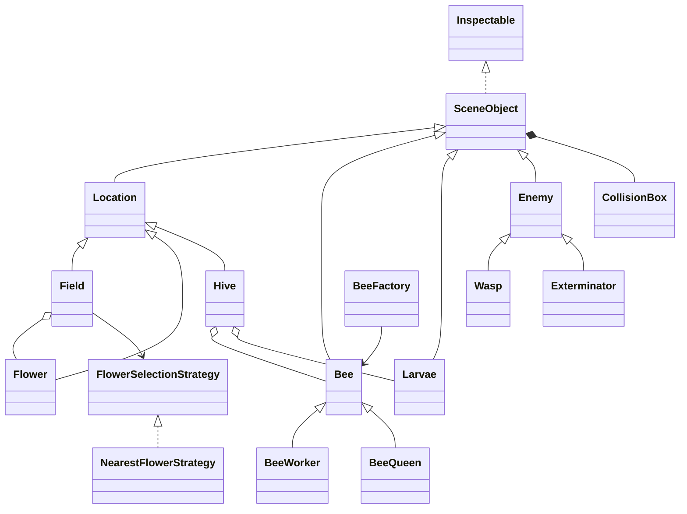
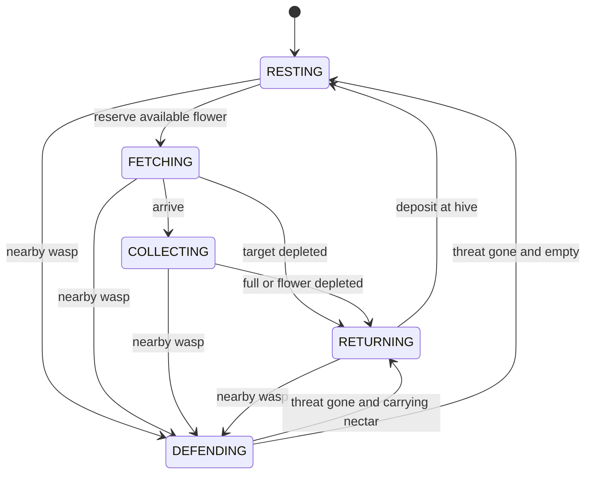

# Code walkthrough

## Follow one frame

1. `App` reads launch options and creates a seeded `Simulation`.
2. `SceneRenderer` handles mouse and keyboard input, then calls `Simulation.advance`.
3. `Simulation` converts elapsed time into fixed 1/60-second updates. Enemies update first, then the hive and the field. Expired enemies are removed afterward.
4. `Hive` updates its bees, removes dead adults, and grows its brood. A mature larva is removed before its adult is added, so hatching still works at the population limit.
5. The renderer draws the current world and reads selected-object statistics through `Inspectable`.

The model uses immutable `Components.Vec3` coordinates and ordinary Java collections. Only `SceneRenderer` and `SceneAssets` depend on Jaylib. This allows behavioral tests to run without opening a window.

## Class relationships

The earlier PNG diagrams are conceptual. In the implemented design, larvae are a distinct life stage, hive honey is a stored quantity, and every object owns a collision box through composition.

## Worker bee state machine

A worker reserves its flower before flying to it. Other workers cannot use that reservation. Leaving the flower, entering defense, or dying releases it. Harvesting clamps the transfer to the remaining pollen and carrying space, so neither resource can go negative.

Movement uses distance per second and stops at the destination. Collection and damage also use rates per second. The fixed simulation step makes the result independent of rendering speed.

## Where the programming requirements are used

| Requirement | Implementation | Why it is useful |
|---|---|---|
| Generics | `ObjectPicker<T extends Inspectable>`, typed collections, `Optional<T>` | One picker supports specific types or the whole scene without casts. |
| Interfaces | `Inspectable`, `Updatable`, `FlowerSelectionStrategy` | Selection, updates, and selection policies have explicit contracts. |
| Abstract classes | `SceneObject`, `Location`, `Bee`, `Enemy` | Common state and behavior are reused; incomplete base objects cannot be instantiated. |
| Factory pattern | `BeeFactory.create` | Adult creation is centralized for manual spawning and larva maturation. |
| Strategy pattern | `FlowerSelectionStrategy` and `NearestFlowerStrategy` | The field can use another flower-selection policy without changing worker behavior. |
| Encapsulation | Private resource fields and read-only collection views | Callers cannot silently alter the hive population or flower collection. |
| Exception handling | Input validation, `App` error boundary, `SceneAssets` cleanup | Bad arguments and missing assets fail clearly; loaded resources are released. |
| Composition | Per-object `CollisionBox` | Moving one object cannot overwrite another object's hitbox. |

## Changes from the supplied prototype

| Original issue | Resulting behavior |
|---|---|
| Type-pattern switch required preview features under Java 17 | Normal Java 17 compilation, with warnings treated as errors. |
| Collision box stored in an interface field | Each scene object owns an independent box. |
| Static hive bee collection | Each hive owns its own adults and brood. |
| Recursive flower choice with ignored return value | Strategy chooses an available flower without recursion. An empty field returns no target. |
| Flower was never released after collecting | Reservations release on return, defense, and death. |
| Collection counted frames and could overdraw pollen | Time-based, bounded resource transfers. |
| Flower list removed items during iteration | Safe removal after the relevant updates. |
| Queen, larvae and exterminator were missing; wasp was a stub | Implemented lifecycle, attacks, defense, raids, spray and visit expiry. |
| Textures loaded for every object | Two textures and one model are loaded once and released on exit. |
| Object selection used loop order | The nearest intersected active object is selected. |
| Build/run instructions were missing | Shell and Windows launchers, headless mode and repeatable tests. |

## Suggested demonstration

1. Start the app and inspect the hive with H.
2. Set speed to 4x with X twice. Watch workers return honey and the queen create brood.
3. Press Q to inspect the queen; use Tab or click a larva to inspect growth.
4. Pause with Space and click a flower. Show its pollen and reservation status.
5. Spawn a wasp with W and resume. Inspect health and watch workers defend.
6. Spawn an exterminator with E. Its spray can harm both bees and wasps.
7. Reset with R. Show that the same initial layout and colony return.
8. Run the tests and explain the reservation, resource-conservation, and lifecycle cases.

The constants near the relevant classes define the simulation balance. The supplied repository does not establish course-specific values for these behaviors.
